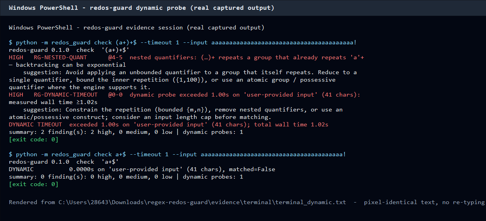

# regex-redos-guard

[](https://github.com/Qin-Z-x/regex-redos-guard/actions/workflows/ci.yml)
[](LICENSE)
[](pyproject.toml)
[](scripts/check_core_deps.py)

> **If this is useful, a star or fork helps others find it.** It is a small, unaided project; stars/fork counts are the honest signal that keeps it maintained. No accounts, no telemetry, no paid promotion.

**Catch catastrophic-backtracking (ReDoS) regexes before code-generating models get them deployed.**
Models happily produce `(a+)+$`, `(a|aa)+$` and `^(\w+)\1+$`; on adversarial input a
backtracking regex engine can hang a service for seconds, minutes or effectively
forever. `regex-redos-guard` applies structural heuristics (nested quantifiers,
overlapping alternations, repeated backreferences, quadratic adjacent repeats) and
optionally **measures real behaviour** with a hard timeout in a child process.
Standard-library-only Python core; no regex executes in the scanning process.

```console
$ python -m redos_guard check '(a+)+$'
redos-guard 0.1.0  check  '(a+)+$'
HIGH   RG-NESTED-QUANT @0-6  nested quantifiers: (a+)+ repeats a group that already repeats a+ — backtracking can be exponential
    suggestion: A repetition of a repetition can usually be reduced: `(X+)+` matches the same strings as `X+`. ...
summary: 1 finding(s): 1 high, 0 medium, 0 low (static only; pass --timeout N for dynamic probes)

$ python -m redos_guard check '(a+)+$' --timeout 1 --input "$(python -c 'print("a"*40+"!")')"
redos-guard 0.1.0  check  '(a+)+$'
HIGH   RG-NESTED-QUANT @0-6  nested quantifiers: …
DYNAMIC TIMEOUT  exceeded 1.00s on 'user-provided input' (41 chars); total wall time 1.01s
summary: 2 finding(s): 2 high, 0 medium, 0 low | dynamic probes: 1

$ python -m redos_guard check 'a+$' --timeout 1 --input "$(python -c 'print("a"*40+"!")')"
redos-guard 0.1.0  check  'a+$'
DYNAMIC          0.000006s on 'user-provided input' (41 chars), matched=False
summary: 0 finding(s): 0 high, 0 medium, 0 low | dynamic probes: 1
```

On the build machine the same 41-character input **timed out** the nested pattern
after 2.03 s (killed by the parent) and the safe rewrite completed in ~6 µs. See
[`docs/EVIDENCE.md`](docs/EVIDENCE.md) for the raw measurements.

## Why this matters (prior art, cited honestly)

| Threat | What it abuses | Reference |
| --- | --- | --- |
| **ReDoS / catastrophic backtracking** | A regex with ambiguous repetition takes exponential time on crafted input; a small request can pin a CPU for hours | Crosby & Wallach, *Regular Expression Denial of Service: Attack and Defense* (USENIX Security 2003); [OWASP ReDoS](https://owasp.org/www-community/attacks/Regular_expression_Denial_of_Service_-_ReDoS) |
| **Real-world outage** | An overly permissive WAF regex caused a large Cloudflare outage in July 2019 | Cloudflare, [Details of the Cloudflare outage on July 2, 2019](https://blog.cloudflare.com/details-of-the-cloudflare-outage-on-july-2-2019/) |
| **Supply-chain ReDoS** | A popular npm package's regex caused denial of service for downstream apps (`ansi-regex`, CVE-2021-3807) | [CVE-2021-3807](https://nvd.nist.gov/vuln/detail/CVE-2021-3807) |
| **LLM-generated code** | Code-generating models write plausible-looking validation regexes without reasoning about worst-case complexity; the code is reviewed for semantics, not complexity | This project's motivating observation (no claim of a model-specific rate) |

**Honest scope.** This project is a **heuristic static analyser plus sampled dynamic
timing tool**. It does not claim a formal worst-case-complexity proof, does not
disclose a new vulnerability and does not claim a new CVE. A clean result is not a
proof; a timeout is a measured failure on the sampled input. See
[`docs/THREAT_MODEL.md`](docs/THREAT_MODEL.md) for the full threat model and limits.

## Install

```bash
git clone https://github.com/Qin-Z-x/regex-redos-guard.git
cd regex-redos-guard
python -m pip install -e .          # optional: installs the `redos-guard` CLI
```

No runtime dependencies. Python 3.10+.

## CLI

```text
redos-guard check <pattern> [--timeout SECONDS] [--input TEXT] [--size N] [--json] [--fail-on {low,medium,high}]
redos-guard scan-file <path> [--timeout SECONDS] [--size N] [--json] [--fail-on {low,medium,high}]
redos-guard explain <pattern>
```

| Exit code | Meaning |
| --- | --- |
| `0` | success; for `check`/`scan-file`, no finding at or above `--fail-on` |
| `1` | `--fail-on` threshold reached (CI gate) |
| `2` | usage error, missing path, or a pattern the analyser cannot parse |

Examples:

```bash
# Static analysis with rewrite hints
python -m redos_guard check '(a+)+$'

# CI gate: fail the build if a risky regex is introduced
python -m redos_guard check '(a|aa)+$' --fail-on high

# Dynamic measurement in a child process (hard per-input timeout)
python -m redos_guard check '(a+)+$' --timeout 2

# Analyse every constant regex in a file or directory
python -m redos_guard scan-file src/ --fail-on high

# Machine-readable output (static + dynamic + caveat)
python -m redos_guard scan-file examples/llm_generated_patterns.py --json
```

`--timeout` is opt-in: without it, only static analysis runs (deterministic, instant).
With it, each generated adversarial input is executed in a separate Python child
process; the parent kills the child at the timeout and reports the measured wall
time.

## Python API

```python
from redos_guard import scan_pattern, explain, check
from redos_guard.dynamic import probe, dynamic_scan

scan_pattern(r"(a+)+$")                   # list[Finding]: static heuristics
explain(r"(a+)+$")                        # dict: findings + suggestions + caveat
check(r"(a+)+$", timeout_s=2.0)           # dict: static + dynamic measurements
probe(r"(a+)+$", "a" * 40 + "!", 1.0)     # dict: one child-process measurement
```

`Finding` fields: `code`, `severity`, `start`, `end`, `message`, `suggestion`,
`data`. JSON shapes are published as JSON Schemas:
[`finding`](docs/finding.schema.json), [`check-result`](docs/check-result.schema.json),
[`scan-file-result`](docs/scan-file-result.schema.json).

## What is detected

| Rule | Severity | Detects |
| --- | --- | --- |
| `RG-NESTED-QUANT` | high (unbounded outer) / medium (bounded outer) | a quantified group that already contains an unbounded quantifier, when the group's start/end character sets overlap (no mandatory delimiter) — e.g. `(a+)+`, `(\w+\s?)+`, `(.*)*` |
| `RG-OVERLAP-ALT` | high / medium | quantified group whose alternation branches overlap (identical, prefix-related, or shared first characters) — e.g. `(a|aa)+`, `(foo|foobar)+` |
| `RG-BACKREF-REPEAT` | high | a backreference inside a repeated group — e.g. `^(\w+)\1+$` |
| `RG-ADJACENT-REPEAT` | medium | adjacent unbounded repeats with overlapping character sets (quadratic risk) — e.g. `\w+\w+`, `.*.*` |
| `RG-DYNAMIC-TIMEOUT` | high | a child-process probe exceeded the configured timeout (measured wall time reported) |
| `RG-DYNAMIC-SLOW` | medium | a probe completed but took longer than 100 ms |

Deliberately **not** flagged: atomic groups (`(?>a+)+`), possessive quantifiers
(`a++`), simple repeats (`a+`), disjoint alternations (`(foo|bar)+`), and
separator-delimited group repeats such as `^[a-z0-9]+(?:-[a-z0-9]+)*$` or
`([a-z0-9]+\.)+` (the mandatory delimiter removes the ambiguity). All are locked in
by tests.

## Design notes

* **A real parser, not regex-on-regex.** A small recursive-descent parser builds an
  AST for the supported syntax (literals, classes, dot, groups including
  non-capturing/atomic/lookarounds, alternation, quantifiers with lazy/possessive
  suffixes, backreferences, anchors, inline flags). Unsupported syntax is reported
  as a parse error rather than silently misanalysed.
* **Delimiter-aware nested-quantifier heuristic.** The classic false positive is
  `^[a-z0-9]+(?:-[a-z0-9]+)*$`: the outer group starts with `-` and the inner
  repetition ends with `[a-z0-9]`, so iteration boundaries are unambiguous. The
  heuristic compares the group's first/last character sets and does not flag it.
* **Child-process isolation for dynamic tests.** The scanning process never compiles
  a hostile regex for execution: every dynamic probe runs in a separate Python
  process with `subprocess.run(timeout=...)`; on timeout the child is killed and the
  observed wall time is reported.
* **Honest severity.** Unverified results are never "safe": static findings carry a
  `suggestion` and every result carries a caveat; dynamic completion is only a
  measurement for the sampled inputs.

## Reproducible demo and evidence

* Synthetic "LLM-generated" pattern file:
  [`examples/llm_generated_patterns.py`](examples/llm_generated_patterns.py).
* Full evidence: [`docs/EVIDENCE.md`](docs/EVIDENCE.md) — static case matrix, real
  child-process timings/timeouts, CLI exit codes, tests.
* Screenshots: [`docs/screenshots/`](docs/screenshots/).
* Video material: [`docs/video_assets.md`](docs/video_assets.md).

**Measured on the build machine** (reproducible via `python scripts/capture_evidence.py`):

| Check | Result |
| --- | --- |
| `(a+)+$` on `a`×40 + `!` (41 chars), 2 s timeout | **TIMEOUT** — killed after **2.03 s** wall time |
| `(a|aa)+$` on the same input, 2 s timeout | **TIMEOUT** — killed after **2.02 s** wall time |
| Safe rewrite `a+$` on the same input | **completed in ~6 µs** (in-child elapsed) |
| Delimited group repeat `(?:-[a-z0-9]+)*$` | **completed in ~2 µs** |
| Static case matrix | 4/4 catastrophic patterns flagged high; 3/3 safe controls have no high findings |
| `scan-file examples/llm_generated_patterns.py` | risky patterns flagged; one non-constant pattern counted as skipped |
| Tests | **86 tests**, all passing |



## Development and tests

```bash
python scripts/check_core_deps.py                # stdlib-only core check
python -m unittest discover -s tests -t .         # 86 tests (dynamic tests use short timeouts)
python -m pytest                                  # same tests through pytest
python scripts/capture_evidence.py                # regenerate EVIDENCE.md + raw evidence + screenshots
```

CI (`.github/workflows/ci.yml`) runs on GitHub Actions for Python 3.10–3.13:
stdlib-only check, `unittest`, `pytest`, static gate outcomes, a real dynamic
timeout on `(a+)+$` (expected exit 1) and a safe rewrite (expected exit 0),
`scan-file` on the example file, and the JSON schema tests.

## Repository layout

```text
redos_guard/           # core parser + static heuristics, dynamic child-process probes, scan-file, CLI
tests/                 # 86 unittest/pytest tests (static, dynamic, files, CLI, schemas)
docs/                  # THREAT_MODEL, EVIDENCE, JSON Schemas, screenshots, video assets
examples/              # synthetic LLM-generated pattern file
scripts/               # evidence capture, stdlib check, terminal screenshot renderer
evidence/              # raw captured evidence (timings, static cases, CLI runs, test output)
.github/workflows/ci.yml
```

## Limitations and responsible use

* Static analysis is heuristic and finite: patterns risky in ways outside the covered
  structures can pass. A clean static result is not a proof.
* Dynamic probes only measure generated or supplied inputs. A fast run proves
  nothing about other inputs; a timeout proves danger on that input.
* Engine-dependent: Python `re` and Java/PCRE/JavaScript are backtracking engines
  affected by this class; RE2/RE2J are linear-time and immune. The tool targets
  backtracking engines.
* `scan-file` analyses Python AST constant patterns only; f-strings/variables are
  reported as skipped, and other languages are out of scope (no guessy JS parser).
* `explain` rewrite suggestions are hints, not verified automatic fixes; check
  equivalence for your intent before applying.
* Use for defence: CI gating, review of model-generated validation code, and
  adversarial-input testing. The demo patterns are textbook examples, not a new
  vulnerability.

## Suggested GitHub topics

`security`, `llm`, `ai-safety`, `redos`, `regex`, `catastrophic-backtracking`,
`denial-of-service`, `static-analysis`, `python`, `cli`

## 中文简介

**regex-redos-guard** 用于在 LLM 生成的正则进入生产前发现 **ReDoS（灾难性回溯）** 风险：
`(a+)+$`、`(a|aa)+$`、`^(\w+)\1+$` 这类模式在短输入上表现正常，遇到恶意长输入却可能让
服务卡死数秒甚至更久。

工具内置一个小型正则解析器，基于结构启发式检测：嵌套量词、重复组中的重叠分支、重复组中的
反向引用、相邻重叠量词（二次方风险）；同时给出改写建议（例如 `(a+)+` → `a+`、使用原子组/占有量词、
限定 `{m,n}` 或加入分隔符）。可选 `--timeout` 在**子进程**中实测真实耗时：超时即终止子进程并
报告实测墙钟时间。核心仅用 Python 标准库，扫描进程本身不执行危险正则。

示例文件 `examples/llm_generated_patterns.py` 中包含 4 个危险模式与安全对照；本机实测
`(a+)+$` 在 41 字符输入上 **2.03 秒超时被杀**，而安全改写 `a+$` 约 **6 微秒**完成；
86 个单元测试全部通过。**诚实声明**：静态分析是启发式、动态测量只覆盖采样输入，均不是
最坏情况复杂度的证明；本工具不声称发现新漏洞或新 CVE。详见
[`docs/THREAT_MODEL.md`](docs/THREAT_MODEL.md)。

## Related projects (same author, independent, stdlib-first)

Other tools by the same author covering adjacent LLM failure surfaces. Each is independent: use or fork only the one you need; every README states its own limits.

- [yixin-go](https://github.com/Qin-Z-x/yixin-go) - local-first Windows Go (weiqi/baduk) sparring partner built on KataGo + Human SL.
- [llm-failbench](https://github.com/Qin-Z-x/llm-failbench) - 100 deterministic, judge-free failure probes for LLMs, with a cited evidence atlas and a CI regression gate.
- [llm-json-doctor](https://github.com/Qin-Z-x/llm-json-doctor) - deterministic repair + JSON Schema validation for malformed LLM JSON; no LLM calls, stdlib only.
- [llm-invisible-guard](https://github.com/Qin-Z-x/llm-invisible-guard) - detect and sanitize invisible-Unicode prompt injection (zero-width, bidi, Unicode-Tag smuggling).
- [llm-exfil-guard](https://github.com/Qin-Z-x/llm-exfil-guard) - detect data exfiltration through rendered LLM output: image beacons, hidden content, remote loads.
- [slopsquat-guard](https://github.com/Qin-Z-x/slopsquat-guard) - flag hallucinated / typosquatted PyPI and npm dependency names before you install them.

If one of these fits your pipeline, a star/fork on that repo is the only help this project asks for.

## License and acknowledgements

MIT — see [LICENSE](LICENSE). Prior art: Crosby & Wallach's ReDoS research,
OWASP's ReDoS guidance, the Cloudflare July 2019 outage analysis, and
CVE-2021-3807 as a supply-chain example. This project is independent and not
affiliated with those authors or vendors.
